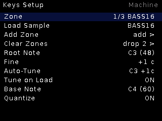
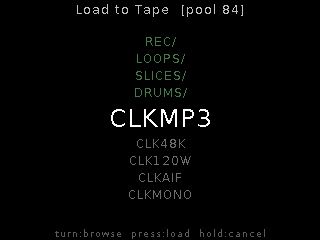

# Common concepts

Conventions every machine shares. Panel context: **8 CV inputs** (CV1/CV2 are
1V/oct-scaled jacks, CV3/CV4 jack-only, CV5–CV8 are jacks with a knob each —
the knob is a summed **offset** on its jack, not an attenuator), **TR1/TR2**
gate inputs (active low; each also has a panel button), one **encoder** (turn / press / long-press), a **GAIN**
knob (the input level), stereo **line in/out** (no CV/gate output — the output is audio only).

## Encoder grammar

- **Turn** — move / adjust. **Press** — select / toggle / small option sets
  cycle in place. **Long press** — switch page (usually Live ↔ Setup).
- **Setup pages** share one framework: option rows cycle on press, numeric
  rows open a `[ bracketed ]` edit (turn changes, press closes), `>` rows are
  actions or sub-pages. The top-right **Machine** affordance jumps to the
  machine selector.
- **Text entry** (sample names, Freesound searches, WiFi settings) is done on
  the panel too: turn picks a character, press enters it, `=` accepts.

## CV matrix

Every machine that reads CV has a **CV Matrix** page (in its Setup). Each
destination (cutoff, level, slice, loop window, FX amounts …) picks a source
— CV1–CV8 or off — and either follows it **absolutely** (the knob *is* the
value) or adds it as an **offset** with an amount. The four panel knobs
appear as ordinary sources (CV5–CV8), so any destination can be re-aimed at
any knob. Each machine's defaults are listed on its page.

## Clock and grid

One **module-wide clock** serves every machine. Its rows (Clock Src, PPQ,
BPM) appear in each machine's Setup and write through to the one shared
setting; the web CLOCK card edits the same values. **Clock Src** is CV1–CV8, `AUDIO` (the beat listener following
the audio input), `INT` (self-clocked at a manual BPM) or `OFF`; **PPQ**
(1/2/4/8 pulses per beat) and an **auto fallback** (INT stands in when the
external clock stops) are global too. The detector locks to pulses with guards
against ghost edges and octave errors. Machines show the locked BPM and derive
grids, quantized loops and synced transports from it. TR1/TR2 are not clock
sources — they stay free for each machine's transport.

## Sample pool

One pool on SD: `usr/` plus the `REC/`, `LOOPS/`, `SLICES/`, `DRUMS/`,
`KEYS/` and `TAPE/` folders (and `TRACKER/` for modules). `.RAW`, `.WAV` and
`.AIFF` play natively; MP3 and other rates/depths are converted once on import
(on upload, or for files copied to the card, with **rescan** on the web
Import / Convert card). Ids
are extension-less, up to **31 characters**, letters, digits, `_` and `-`.

New takes are numbered: recordings `REC_NNNN`, bounces `BNC_NNNN`, Looper
saves `LOOPNNNN`, Tape takes `CUT_NNNN` (whole take) and `TLP_NNNN` (a cropped
loop), Tape card recordings `TAP_NNNN`.

The **browser** (encoder press in most machines) opens on folders: `ALL/`
(every sample, newest first), `POOL/` (`usr/`) and one per pool folder. Turn
to browse, press to open a folder or load, long-press to cancel.

## Knob takeover

A knob mapped absolutely in the CV matrix doesn't jump a setting the moment a
machine starts or a patch loads. Depending on the destination it either waits
until it **moves** (then takes over) or until it **crosses** the current value
(no jump at all — used where a jump would be loud, like a filter cutoff).

## Web interface

`http://<ip>/` (or `http://stramp.local/`) serves one page of cards:

- **Panel** — live screen mirror, encoder and trigger buttons, CV knobs and
  jacks (drag to inject CV).
- **Machine** — the active machine's settings (only what you change is sent),
  its CV matrix and FX, plus cards some machines add (Radio, Editor,
  Freesound). The cards follow a machine switch made on the panel.
- **Clock**, **Keyboard** (soft MIDI / QWERTY), **System** (settings, WiFi,
  OTA, reboot).
- **Files** — the pool: rename, move, delete, download, and **load the
  selected sample into the active machine** (with a slot picker on machines
  that have voices, decks, pads or zones). Upload converts anything in the
  browser; **Import / Convert** rescans the card.
- **Bounce** and **Broadcast** (below).

## Broadcast & bounce (any machine)

- **Bounce** — record the machine's *output* to a new `BNC_` pool take
  (web BOUNCE card or `POST /bounce/start|stop`). It keeps running across a
  machine switch.
- **Broadcast** — live streams on port 8000: `/` stereo WAV, `/live.mp3`
  96k mono MP3 (icecast-style), `/in` + `/in.mp3` the same taps on the
  **line input** (streaming bridge). One listener at a time.
- **Icecast push** — the module can act as a *source client*, pushing the
  output as MP3 to an icecast mountpoint (web BROADCAST card → PUSH).
  Note: MP3 encoding is not realtime while Radio is playing.

## Settings and safety

Each machine remembers its settings (autosave) across switches and reboots.
Settings and the autosave are written with a backup copy; if power is cut
in the middle of a write, the next boot restores the backup.
