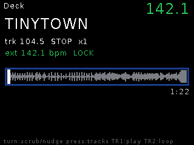
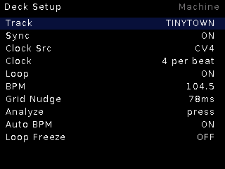

# Deck

**Tempo-syncing track player.** Streams long tracks from SD and phase-locks
their playback speed to the module clock — a turntable that always plays
in time with the rack.

## Features

- **Varispeed playback phase-locked** to the clock (pulse-level PLL, so any
  Clock PPQ setting works). Measured lock: ~90 % of beats within ±7 ms.
- **Offline BPM + beat-grid analysis** (±0.0005 BPM on reference material),
  cached in the track's sidecar. With Auto BPM on it runs by itself on an
  unanalyzed track; it pauses while the track plays and the Live page shows
  its progress.
- **Loop** — streamed beat-ladder loops (1/4 to 256 beats), window moves
  scheduled seamlessly, no PLL reset on wrap. Play/pause inside a loop
  resumes at the same beat in the window, also after a window move.
- **Resync gesture**: hold TR1 + TR2 together and release on the beat; the
  track slides to the nearest beat and the lock point moves with it.
- Grid Nudge for fine phase alignment; per-track BPM stamps and Feel.
- Transport bar: grey waveform, white playhead; while looping the box
  shrinks to frame the loop window.

## Controls

| Control | Function |
|---|---|
| TR1 | Tap = play/pause, hold = restart at downbeat |
| TR2 | Press = loop on/off, hold = momentary loop |
| TR1 + TR2 held | Resync on release |
| Encoder turn | Synced and locked: phase nudge. Otherwise: one-bar scrub |
| Encoder press | Track browser (newest first) |
| Encoder long | Live ↔ Setup |

Knob defaults (CV Matrix): K5 loop window, K6 DJ filter (noon = bypass,
left = low-pass, right = high-pass), K7 speed (synced: half / normal /
double; free-running: 0.5x to 2x), K8 loop length. The loop pair only acts
while a loop is engaged.

## Setup

Track, Sync, Clock Src, Clock (PPQ), Loop (track loop), BPM, Grid Nudge,
Analyze, Auto BPM, Loop Freeze (on: leaving a loop plays on from the
loop; off: jumps to where the track would have been), Feel (x0.5 / x1 / x2, saved per track),
Clk Scale (x0.5 / x1 / x2 on the incoming clock), CV Matrix.

Clock Src and Clock edit the module-wide clock, not a Deck setting.

## Tips

- Deck audio is legitimately rough for ~60 s after boot and ~15 s after
  scrubs (ring refill + PLL relock) — judge sync only after it settles.
- Fresh uploads have no BPM stamp yet: load once, stop, and let
  auto-analysis run.
- The web file browser can load a track straight into Deck.
