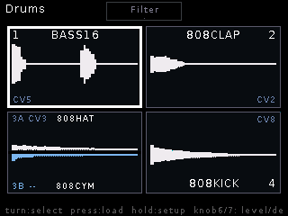
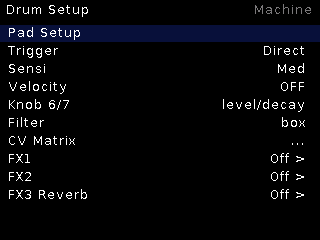

# Drums

**Four-pad one-shot drum sampler** — but each pad can carry a second **choke
layer**, so it's 4 cells, up to 8 sounds, 8 triggers. The classic use: open
and closed hi-hat on one pad, each cutting the other off.

## Features

- 4 mono RAM pads; per-pad **A/B choke layers** sharing one voice (either
  hit interrupts the other).
- Trigger modes: **Direct** (each layer fires from its own CV input; pads
  1–4 default to CV1–CV4, B layers start unrouted) or **CV-select**
  (TR1/TR2 fire, a selector CV picks the pad; with layers TR1 = A, TR2 = B).
- **Performance knobs**, neutral at noon, taking over only when moved, acting
  on the pad the encoder points at:
  - K6 = level (noon unity, clockwise drives up to 4× through a soft clipper)
  - K7 = counterclockwise decay choke; clockwise one of the pad's Knob7 CW
    targets (retrig / attack / start / pitch / none), retrig with repeat caps
- **Master filter** — a box in the middle of the pad grid; press it to
  engage or bypass. K5 = DJ-style sweep (LP↔HP through noon), K8 =
  resonance. All four knobs are live at once.
- Per-pad **pitch** ±12 semitones, with an optional pitch CV (`+/-` or
  `V/oct`) that retunes a ringing pad.
- **FX1 / FX2** effect slots on an FX bus (per-pad FX on/off), and the
  **FX3 reverb** fed by per-pad sends, with a pre/post-filter Send Tap.
- Lazy buffers — an empty kit costs no RAM. Loading onto a ringing pad cuts
  it cleanly. A layer that failed to load keeps its name; pick it again to
  retry.
- Sample names up to 31 characters. The web file browser can load a sample
  straight onto any pad's A or B layer.

## Controls

| Control | Function |
|---|---|
| CV1–4 | Pad 1–4 triggers (Direct mode defaults; any layer can use any CV) |
| TR1/TR2 | Pad fire (CV-select mode / layer A/B) |
| Encoder | Trace the pad grid circularly (half-cells for layered pads); press = load into the selected half |
| K5–K8 | Filter sweep / pad level / pad decay+CW target / resonance (CV matrix defaults) |
| Encoder long | Live ↔ Setup |

In CV-select mode the selectors default to CV6 and CV7, which holds the
level and decay knobs off while they select pads.

## Setup

Pad Setup (per pad: B Layer, Layer, Sample, Trig In, Level, Pan, Rev Send,
FX, Pitch, Pitch CV, Pitch Mode, Decay, Knob7 CW, Retrig, Enabled), Trigger,
Sensi, Sel CV TR1/TR2 (CV-select only), Velocity, Knob 6/7, Filter,
CV Matrix, FX1, FX2, FX3 Reverb, Send Tap.
