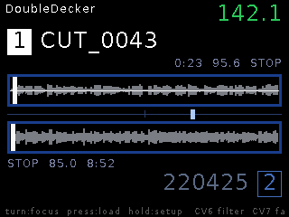
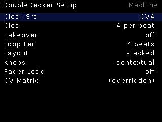

# DoubleDecker

**Two synced Decks and a crossfader.** Both decks phase-lock to the same
clock; the crossfader blends them with equal power, and a DJ filter sweeps
the focused deck — a two-turntable rig in 18HP.

## Features

- Two independent streamed decks, each with the Deck's PLL sync engine.
- **Auto-BPM**: loading an unstamped track analyzes it in the background
  (stopped deck only) so both decks can loop.
- **Per-deck DJ filter** (LP↔HP sweep, noon = bypass).
- **Loops** per deck (KO-II style ladder, 1/4 to 256 beats), beat-true
  engage, momentary loop.
- **Quantized transport**: with a locked clock, starts and stops land on the
  next bar.
- **Both-trig resync gesture** on the focused deck.
- **Takeover**: optionally move the crossfader to a deck when it starts.
- Layouts: stacked or side-by-side. Knobs can be fixed (the CV Matrix) or
  contextual (they follow the focused deck).

## Controls

| Control | Function |
|---|---|
| TR1 | Focused deck: tap = start/restart, hold = stop |
| TR2 | Focused deck: press = loop toggle, hold = momentary loop |
| TR1 + TR2 held | Resync the focused deck on release |
| Encoder turn | Switch focus between deck A and deck B |
| Encoder press | Load a track into the focused deck (not while it plays) |
| Encoder long | Live ↔ Setup |

Knob defaults (CV Matrix): K5 loop window, K6 DJ filter, K7 crossfade,
K8 loop length. Both decks share the loop pair and it drives the focused
deck; give deck B its own channels and both decks answer at once.
Contextual knobs put filter and loop window on K6 and crossfade and loop
length on K7; with Fader Lock on, K7 stays the crossfader.

## Setup

Clock Src, Clock (PPQ), Takeover (off / cut / 1, 4 or 8 beats), Loop Len,
Layout, Knobs (fixed / contextual), Fader Lock, CV Matrix.

Clock Src and Clock edit the module-wide clock. The web file browser can
load a track into deck A or deck B.
