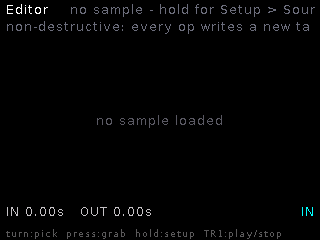

# Editor

**Non-destructive file editor for pool samples**, driven from the panel.
Load a sample, set a range on its waveform, and apply an op — each op streams
the source through a transform and writes a *new* take, so originals are
never touched. Files can be minutes long and stereo. (For recording and
printing effects see [Tape](tape.md).)

## Features

- **Live page = the waveform** of the whole file with an IN/OUT range. The
  ops act on the range only and pass the rest of the file through unchanged.
- Ops: **normalize** (two-pass peak), **reverse**, **fade in/out**,
  **trim silence** (two-pass), **crop** (writes just the range).
- **Audition**: TR1 plays/stops the range as a loop; the loop follows the
  range while you move it.
- **Copy / Cut / Paste** through a file clipboard: cut writes a new take
  without the range, paste writes a new take with the clipboard inserted at
  IN.
- **Slice**: the range into N equal slices (`SLC_NNNN` in `usr/SLICES`)
  plus an `.OT` map the Slicer can load.
- Ops run as a background job; outputs are short generated ids (`NM_`,
  `RV_`, `FI_`, `FO_`, `TR_`, `CR_` + number) landing back in the pool.

## Controls

| Control | Function |
|---|---|
| TR1 | Audition play / stop (Live page) |
| Encoder turn | Pick cursor IN → OUT → WIN → ZOOM; when grabbed, move it |
| Encoder press | Grab / release the cursor |
| Encoder long | Release a grab, else Setup |

WIN slides the whole range, keeping its length; ZOOM zooms the view around it.

**Setup**: Source (pick a pool sample), Op, Param (fade length in ms, or the
trim threshold), Apply, Audition, Copy, Cut, Paste, Slices (1–64), Slice,
Zoom All.

**Web**: the Editor card picks a sample and runs any op, using the range set
on the panel (or the whole file); a file browser "load to machine" opens a
sample as the Editor's source. REST while active:
`/edit/apply?name=<id>&op=<0..5>[&param=…][&in=&out=]`, `/edit/load?name=<id>`,
`/edit/state`.
