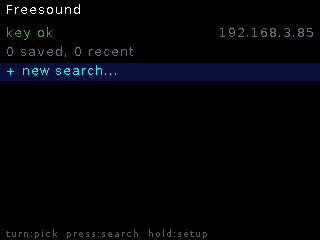

# Freesound

**Search freesound.org and pull sounds into the pool** — from the panel with
the encoder, or from the web card. Needs WiFi and a freesound API key.

## Features

- **Live page = the query list**: recent searches, saved searches, and
  `+ new search...`. The header shows `key ok` / `NO API KEY` and the IP (or
  `no wifi`); a status line shows the download in progress or the last error.
- **New search** opens on-screen text entry, seeded with the last query:
  turn picks a character, press commits it, long press commits it
  uppercased; turn past `z` for `<` backspace, `^` cancel, `=` accept.
- **Results**: 16 per page with durations; turning past the last or first
  result loads the next or previous page.
- **Get + hear**: press a result to download it; if it is already in the
  pool, press plays it (looped) instead, and press again stops. With
  **Auto-play** on, a download plays as soon as it lands.
- Downloads are the high-quality MP3 preview (up to 90 s), converted at any
  sample rate to a 44.1 kHz stereo pool take with a sidecar (credit + license).
- **Naming**: the take is named after the sound's title. If that name is
  already taken by a different sound, it becomes `<title>_<id>`.
- Errors say why: a rejected API key, rate limiting, an HTTP status, or no
  reply from freesound.

## Controls

| Control | Function |
|---|---|
| Encoder turn | Pick a query / browse results |
| Encoder press | Run the query / get or hear the result |
| Encoder long | Setup (from Live) / back to the query list (from Results) |

**Setup**: New Search, Save Query (press again to un-save), Clear Recents,
Auto-play, Drop Last (stops and deletes the take just heard or downloaded).
No TR or CV jobs.

**Web Freesound card** (while the machine is active): search box (drives the
same device search and result list the panel shows), recent/saved chips,
Prev/Next, **Get** with an inline "Save as" name, and a direct-URL fetch
(MP3, up to 6 MB; the name must be free).

## Notes

The API key is set in **System → Settings → Api Key** (panel text entry, or
the web Settings screen). The web page never reads the key back; it only
shows whether one is set. Original-quality downloads (OAuth) are not
implemented; previews are the download path.
