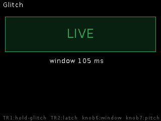
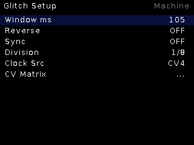

# Glitch

**Live-input stutter / beat-repeat.** No SD, no samples — the line input
passes through and is kept in a rolling buffer; a stutter grabs the most
recent window and repeats it, clock-synced when a clock is patched.

## Features

- Rolling capture window (**Window ms**, 20–500) over the live input.
- **Sync** to the core clock with a **Division** ladder (1/4, 1/8, 1/16,
  1/32 notes; 1/4 = one beat) so repeats land musically; with Sync off, or no clock
  locked, the window is Window ms.
- **Reverse** repeats; **pitch** from 0.5x to 2x with a unity zone
  around the centre.
- Live page: a large LIVE / GLITCH state box, the window size with REV and
  LATCH flags, and the sync division with the clock tempo (or "no clock").
- **CV matrix** (Setup > CV Matrix): Window, Pitch, Level — each assignable
  to any CV source as a knob or a signed offset.
- Zero storage: everything is RAM, instant.

## Controls

| Control | Function |
|---|---|
| TR1 | Hold-glitch (stutter while held) |
| TR2 | Latch (each trigger toggles the stutter) |
| Knob 6 | Window size |
| Knob 7 | Pitch |
| CV1 | Level |
| Encoder long | Live ↔ Setup |

The knob and CV1 jobs are the CV matrix defaults; knobs 5 and 8 are free.

## Setup

Window ms, Reverse, Sync, Division, Clock Src (the module-wide clock
source), CV Matrix.
