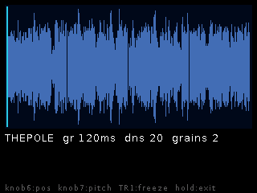
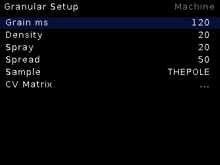

# Granular

**16-grain cloud** over a mono pool sample. Raised-cosine grains scattered
around a position cursor — from clean time-stretch textures to smeared clouds.

## Features

- 16 simultaneous grains, raised-cosine windowed (clickless).
- **Grain ms** (size, 10–500), **Density** (grains per second, 1–120),
  **Spray** (position randomization) and **Spread** (stereo scatter).
- **Pitch** from 0.5x to 2x, with a unity zone around the centre.
- Any pool sample via the shared browser (names up to 31 characters; up to
  12 s of mono audio is used). A sample loaded from the web page's file list
  shows on the Live page without leaving it.
- Live page: the sample's waveform with the cloud position marker, and a
  line with the sample name, grain size, density and active grain count.
- **CV matrix** (Setup > CV Matrix): Position, Pitch, Grain size, Density,
  Level — each assignable to any CV source as a knob or a signed offset.

## Controls

| Control | Function |
|---|---|
| Knob 5 | Grain size |
| Knob 6 | Position cursor |
| Knob 7 | Pitch |
| Knob 8 | Density |
| CV1 | Level |
| TR1 | Freeze (holds the cloud position while the gate is on) |
| Encoder long | Live ↔ Setup |

The knob and CV1 jobs are the CV matrix defaults and can be changed there.

## Setup

Grain ms, Density, Spray, Spread, Sample, CV Matrix.
