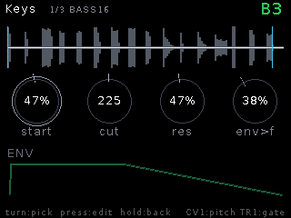

# Keys

**Tonal instrument sampler** — load a sample, tell it the root note (or let
Auto-Tune find it), and play it pitched over ±2 octaves from 1V/oct with a
**sustain loop** so held notes ring for as long as the gate does. Up to
**8 zones** make it a multisampler.

## Features

- Resident mono samples (cubic-interpolated varispeed — clean high end).
- **Zones**: up to 8 samples, each note plays the zone with the nearest root.
  `Load Sample` replaces the whole set, `Add Zone` appends one, `Clear Zones`
  keeps zone 1 and drops the rest. All zones share one memory block, so total
  length runs out before zone count does. A zone that fails to load stays in
  the patch and is retried on the next load.
- **Auto-Tune** detects a zone's pitch and writes Root Note + Fine; the row
  shows the verdict and where it came from. **Tune on Load** runs it on every
  fresh load.
- **Forward sustain loop** per zone: Loop Start/End with zero-crossing snap
  and a wrap **crossfade**; releases play through naturally.
- **ADSR** + envelope-opened low-pass; glide; quantize.
- **LFO** to cutoff or pitch: rate/depth, five shapes (sine/tri/saw/sqr/rnd)
  and optional **tempo sync** to the core clock, 4 bars to 1/16.
- **CV matrix** destinations: Cutoff, Reso, Env>Cut, Level, Pitch, Start,
  LoopMov, LoopLen. The knobs are matrix entries with takeover: K5 start,
  K6 cutoff, K7 reso, K8 env>cut.
- **FX1 / FX2 / FX3 Reverb** slots (no Filter or Band effect — the voice
  filter is the one filter). **Named patches** (`Save Patch` / `Load Patch`).
- Live dashboard: waveform strip with the loop window boxed and a playhead,
  note name, macro dials, and a bottom strip that switches between the ADSR
  and the LFO (press its header). While a note sounds, Live shows the zone
  that note is playing. Turning a loop edge moves it about one pixel per
  detent; pressing into an edge turns the loop on.
- Web MIDI plays it too. Sample names up to 31 characters; the web file
  browser can replace the set or add a zone.

## Controls

| Control | Function |
|---|---|
| CV1 | 1V/oct pitch (input selectable) |
| TR1 | Gate, retriggers from the start offset (TR1 or TR2 selectable) |
| Knobs 5–8 | start / cutoff / res / env>cut (CV matrix defaults, takeover) |
| Encoder | Pick an element, press to edit, long to leave edit |
| Encoder long | Live ↔ Setup |

## Setup

Zone, Load Sample, Add Zone, Clear Zones, Root Note, Fine, Auto-Tune,
Tune on Load, Base Note, Quantize, Loop Mode/Start/End/Xfade, Attack, Decay,
Sustain, Release, Env>Cut, Glide, LFO Rate/Depth/Dest/Sync/Div/Shape, Level,
CV Matrix, FX1, FX2, FX3 Reverb, Save Patch, Load Patch. `Zone` picks which
zone the per-zone rows (sample, root, fine, loop) edit.
