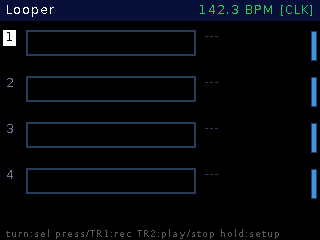
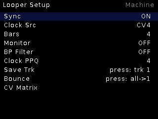

# Looper

**4-track clock-synced RAM looper.** Record layered loops against the module
clock, save any track to the pool, shape each track with a band-pass filter.

## Features

- Four independent mono tracks in RAM, up to 8 s each. With Sync on and a
  locked clock, recording starts on the next bar and stops after **Bars**
  (1, 2, 4 or 8); the loop length is sample-exact to the clock. With Sync
  off or no clock, a take runs until you punch out or the 8 s fill.
- **Save Trk** writes the selected track to `usr/LOOPS/` as a `LOOPNNNN`
  WAV.
- **Bounce** mixes all tracks down to track 1 and clears tracks 2–4.
- Only one save or bounce runs at a time; a second one shows BUSY.
- Per-track **BP filter**, level and pan. All four CV Matrix destinations
  drive the selected track.
- Monitor toggle for hearing the input while overdubbing.
- If memory is short at start, Looper runs with the tracks it could get;
  a missing track will not record.

## Controls

| Control | Function |
|---|---|
| TR1 | Selected track: record / action (same as encoder press) |
| TR2 | Selected track: play / stop |
| Encoder turn | Select track |
| Encoder press | Selected track: arm/record, cancel, punch out, stop, re-record |
| Encoder long | Live ↔ Setup |

Each press steps the selected track on: empty → armed (or recording when
unsynced) → playing → stopped → re-record. Pressing while recording punches
out early.

CV Matrix defaults: CV6 track level, CV7 track pan, CV1 cutoff and CV2
resonance (the filter pair acts only while BP Filter is on). If TR1 or TR2
is chosen as the clock source (web settings), that trigger stops acting as
a button.

## Live page

Waveform-thumbnail lanes, one per track, with a state-colored playhead
(record = red, play = white) and the selected lane's number on a white plate.

## Setup

Sync, Clock Src, Bars, Monitor, BP Filter, Clock PPQ, Save Trk, Bounce,
CV Matrix. Clock Src and Clock PPQ edit the module-wide clock.
