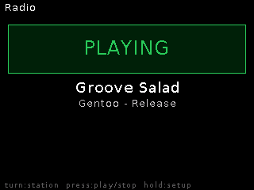

# Radio

**Internet radio in the rack.** Streams icecast/shoutcast MP3 stations
(http and https) through the module — and because bounce and broadcast are
core services, you can *sample the radio* or re-stream it.

## Features

- Helix MP3 decode of endless streams into a 4 s ring; pre-buffers ~0.5 s,
  shows ICY **now-playing** metadata.
- **Reconnects on its own** after a dropped stream or a connect/header
  timeout, and follows redirects. After repeated failures it stops and shows
  the reason (`connect failed`, `no response`, `stream lost`).
- **Any sample rate 8–48 kHz** — non-44.1k stations (48k is common) are
  cubic-resampled live to the module's rate.
- **Station list**: six built-in stations (five SomaFM plus SPAZ); add your
  own from the web card — by URL or by importing an `.m3u`/`.m3u8`
  playlist — and delete them again. Saved stations live in `usr/radio.jsn`
  (up to 24 stations in all). Built-ins can't be deleted.
- The selected station is saved with the machine's settings, and a web
  Apply of other settings keeps the station that is playing.

## Controls

| Control | Function |
|---|---|
| Encoder turn | Pick a station (while stopped or after an error) |
| Encoder press | Play the selected station / stop |
| Encoder long | Setup (Stop, and Machine to reach System) |
| Web Radio card | Now playing + buffer bar, station buttons (× deletes a saved one), custom URL Play / Save, Import .m3u playlist, Stop |
| REST | `/radio/play?station=N` or `?url=…`, `/radio/stop`, `/radio/state`, `/radio/station/save?url=…&name=…`, `/radio/station/del?i=N` |

Radio has no TR or CV jobs.

## Tips

- **Sample the radio**: Remote page → BOUNCE while playing → a `BNC_` take
  lands in the pool.
- Radio + the MP3 broadcast encoder don't fit the CPU together — while Radio
  plays, use the WAV broadcast or bounce instead, and stop Radio before OTA
  updates (it starves internal RAM).
