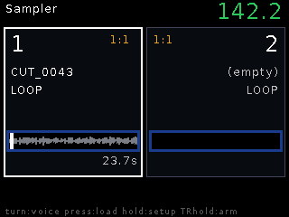
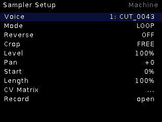

# Sampler

Two-voice **clock-time loop recorder**. Each voice records a take against the
clock, then loops a crop window of it — start/length performable at CV rate
without glitches. The synced-record workflow runs from an external clock or
the module's internal clock.

## Features

- Per-voice **recorded takes** (line in), auto-pickup of finished recordings,
  explicit Record page with ARM/REC banner. With the clock locked, a take
  starts on the next pulse and stops on the next whole beat.
- **Gate workflow**: press a voice's gate to play or pause it; hold it ~1 s
  to arm that voice for recording; while armed, press to start the take and
  press again to stop it. Holding through a take you just started discards it.
  Turning the encoder on Live disarms.
- **Crop windows** (start + length) with four modes: `OFF`, `FREE`,
  `QUANT`, `QUANTx2` — quantized modes snap crop points to whole beats of the
  take's BPM stamp.
- **Streamed playback**: 1 s RAM head for instant gate retrig + SD streaming
  for the tail; loop wraps are seamless with a ~6 ms crossfade.
- **Reverse** plays the whole take backwards.
- **CV matrix** (Setup > CV Matrix): Speed / Crop Start / Crop Len per voice.
  Defaults: K5 crop start 1, K6 speed 1, K7 speed 2, K8 crop start 2, each
  taking over only once the knob moves. Speed is unity at noon, up to 1.5x
  clockwise, and down through a stop into reverse counter-clockwise.
- **Joint grid snap**: hold BOTH gates ~1 s → both loops restart from their
  window starts on the same clock pulse.
- Sample names up to 31 characters. The web file browser can load a sample
  straight into voice 1 or voice 2.

## Controls

| Control | Function |
|---|---|
| TR1 / TR2 | Gate voice 1 / voice 2 (press = play/pause, hold ~1 s = arm) |
| Encoder turn | Switch voice focus (disarms an armed voice) |
| Encoder press | Sample browser for the focused voice (newest first) |
| Encoder long | Live ↔ Setup |
| CV matrix | Speed / Crop Start / Crop Len per voice, any CV source |

## Setup

Voice, Mode (LOOP / ONE-SHOT), Reverse, Crop, Level, Pan, Start, Length,
CV Matrix, Record. The Record page holds Arm V1, Arm V2, Monitor, Arm mutes,
and three rows that edit the module-wide clock: Int Clock (BPM; hold for
auto-fallback), Clock PPQ, Clock Src.

The Live page shows mirrored side-by-side voice panels: black canvas, bold
waveform, and a state-colored box whose ends sit AT the crop points — the box
IS the loop window. A `1:1` badge shows when a voice plays at native speed.
