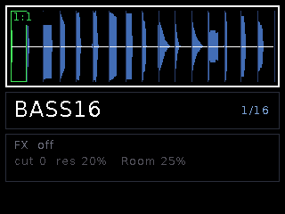
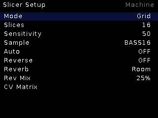

# Slicer

**Any-length sample slicer.** Chop a pool sample into slices by grid,
transient detection, or an imported Octatrack `.ot` file, and fire them from
triggers/CV. No length ceiling: slice attacks live in RAM, tails stream from
SD while a slice plays.

## Features

- **Three slicing modes**: `Grid` (equal divisions), `Transient` detection
  with a **Sensitivity** dial-in screen, or `OT` (offered when the sample has
  a `.ot` file next to it). A Grid or Transient choice made over a sample's
  `.ot` is saved for that sample; loading a different sample uses its own
  `.ot`. The web page can download the current slices as a `.ot` (up to 64
  slices).
- **Streaming architecture**: per-slice 80 ms attack heads in RAM, the
  playing slice's tail streamed into a 2 s ring — works on an 8-minute file
  as easily as an 8-second one.
- **Reverse** playback. **Auto** walks on to the next slice
  when one ends.
- **FX box** on Live: a DJ-style filter (low-pass left of noon, bypass at
  noon, high-pass right) with resonance, then a reverb (Room/Hall/Plate/
  Shimmer) with mix. Both run only while the box is ON.
- Speed: unity plateau at noon, 0.5x–2x. Pitch from a 1V/oct jack, quantized
  to semitones.
- Async loads with progress — a long file scans peaks + envelope in the
  background (~1.5 min per 8 min of audio). Sample names up to 31 characters;
  the web file browser can load a sample straight into the Slicer.

## Controls

| Control | Function |
|---|---|
| TR1 | Fire the selected slice |
| TR2 | Fire the selected slice and step to the next |
| CV1 | Pitch, 1V/oct (input selectable) |
| CV matrix | Slice (CV3), Speed (K7), Filter (K6), Reso (K8); Level, Pitch unassigned |
| Encoder | Pick Slices / File / FX; press into the slice bar, turn to select, press to play, long to leave |
| Encoder long | Live ↔ Setup |

## Setup

Mode (Grid/Transient/OT), Slices (Auto/8/16/32/64/128), Sensitivity, Sample,
Auto, Reverse, Reverb, Rev Mix, CV Matrix.
