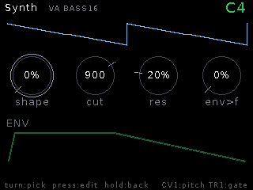
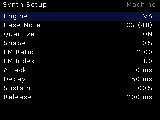

# Synth

**No-sample sound source** — a complete mono voice: three engines
(virtual-analog, 2-op FM, wavetable), ADSR, envelope-driven filter, glide,
LFO and the shared FX rack. Patch a keyboard/sequencer's 1V/oct + gate and
play it.

## Features

- **Engines**: `VA` polyBLEP saw↔square with shape morph; `FM` 2-op with
  ratio + index; `WT` wavetable — load any pool sample (names up to 31
  characters) as the table via Load Wave, which also selects WT. A wave sent
  from the web page's file list (the load button) shows in the Live header
  next to the engine tag; select `WT` to hear it.
- **Pitch**: CV1 at 1V/oct (calibrated to this unit), quantize-to-semitone
  toggle, Base Note, **glide**. Web MIDI notes play the voice too.
- Linear **ADSR** → VCA; low-pass filter with resonance, envelope amount to
  cutoff (`Env>Cut`).
- **LFO** to cutoff or pitch: rate/depth, five shapes (sine/tri/saw/sqr/rnd)
  and optional **tempo sync** to the core clock in divisions from 4 bars to
  1/16. Synced, `rnd` steps once per division.
- **FX**: FX1 and FX2 are generic slots (Off/Overdrive/Flanger/Tremolo/Delay);
  FX3 is the reverb (Room/Hall/Plate/Shimmer) with mix. There is no Filter or
  Band slot — the voice has its own filter.
- **CV matrix** (Setup > CV Matrix): 8 destinations — Cutoff, Reso, Timbre,
  Env>Cut, LFO Rate, LFO Dep, Level, Pitch — each assignable to any CV source
  with a signed amount, or as a `knob` (the source sets the value once moved).
- **Named patches**: Save Patch mints `PAT_NNN`; Load Patch opens a
  newest-first browser.

## Live page

Turn to pick an element, press to edit it. Long-press leaves edit; with
nothing in edit it goes to Setup. Elements: the engine tag + waveform (edit = VA/FM/WT), four
dials (timbre — shape, FM index or WT fold by engine — cutoff, resonance,
env>cut), then the bottom strip. Press its `ENV`/`LFO` title to switch the
strip between the ADSR points and the LFO cells (sync, div/rate, shape, amt,
dest).

## Controls

| Control | Function |
|---|---|
| CV1 | 1V/oct pitch (any CV1–CV8 can be picked from the web page) |
| TR1 | Gate (ADSR); TR2 can be picked instead |
| Knob 5 / 6 / 7 / 8 | Timbre / cutoff / resonance / env>cut (CV matrix defaults) |
| Encoder long | Live ↔ Setup |

## Setup

Engine, Base Note, Quantize, Shape, FM Ratio, FM Index, Attack, Decay,
Sustain, Release, Env>Cut, Glide, LFO Rate, LFO Depth, LFO Dest, LFO Sync,
LFO Div, LFO Shape, Level, Load Wave, CV Matrix, FX1, FX2, FX3 Reverb,
Save Patch, Load Patch.
