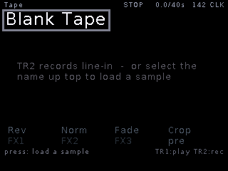
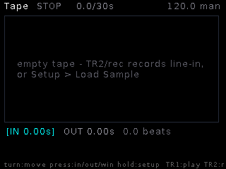

# Tape

**Single-track tape recorder/editor.** One mono tape (15, 30 or 40 s) you
record line-in onto — or load any pool sample — then *see*: the whole screen
is one big waveform with a crop window, a beat grid, and a playhead. Edit
with the encoder, print effects to tape, splice with cut/copy/paste, and
drop loops back to the pool.

## Features

- **The screen is the editor**: full-tape waveform, crop window boxed bright
  (material outside dimmed), beat-grid ticks **anchored at the IN point**
  (every 4th beat brighter), playhead coloured by transport state.
- **Grid** from the module clock; crop moves snap to beats, or to
  zero-crossings with no tempo. **Crop Beats** (1–32) sets the window to an
  exact musical length.
- **Signal path**: a tone stage (filter LP/BP/HP + drive) that is always
  printed, then the FX rack (FX1, FX2, FX3 reverb). **FX Route** sets the
  rack pre (printed to tape on record), post (the tape stays dry and the
  rack colours playback; the first punch-in switches it to pre) or off. `Rec Source: tape` re-prints the tape itself through the chain.
- **Recorder**: TR2 punches in/out; a fresh take fills the tape from the
  top, recording while playing overwrites inside the loop. Holding TR2
  ~0.7 s after punching in erases the tape and starts the new take when
  you let go. Rec Quant ends a fresh take on the next beat or bar.
  Rec Dest `card` records long takes straight to `usr/REC` as `TAP_` WAVs.
- **Editing** (transport stopped): **cut / copy / paste** via a clipboard,
  normalize, reverse, fade edges. A Cut with no room for the clipboard is
  refused ("no room") and keeps the old clipboard.
- **Takes save themselves** to `usr/TAPE`: a finished recording as a
  `CUT_` file; an edited take as a whole-take `CUT_` file after ~10 s with
  no edits. With a crop set, leaving Tape or loading another sample writes
  the crop as a `TLP_` file and keeps it as the take. Tape reloads the last
  take when you come back.
- **Crop** (Live button or Setup > Crop Loop) saves the loop you hear as a
  `TLP_` take and crops the tape to it; it works while playing.

## Controls

| Control | Function |
|---|---|
| TR1 | Play / stop (transport) |
| TR2 | Record punch in/out |
| Encoder turn | Move the selection; with a crop point grabbed, move it |
| Encoder press | Name: load a sample. IN / WIN / OUT: grab, press again to drop. Buttons: fire |
| Encoder long | Setup (or release a grabbed point) |

Live buttons: Rev, Norm, Fade, Crop, FX1, FX2, FX3 (press cycles the
effect), Route (pre / post / off). TR1 and TR2 can be swapped in the web
CV Matrix card. Knob defaults (CV Matrix): K5 window move, K6 cutoff,
K7 resonance; K8 is free. Other destinations: Crop In, Crop Out, Level,
two per FX slot (named after the loaded effect) and Rev Mix.

## Setup

Crop Beats, Clock Src, Manual BPM, Filter, Cutoff, Reso, Drive, Level,
Rec Source, Monitor, FX1, FX2, FX3 Reverb, Copy, Cut, Paste, Normalize,
Reverse, Fade Edges, Crop Loop, Load Sample, Clear Tape, Tape Len (clears
the tape; trims if RAM is tight), Rec Mode (punch / momentary), Play Mode
(loop / one-shot), Rec Dest, Rec Quant, CV Matrix, FX Route.

Loading from the web file browser is refused while the tape rolls;
otherwise it is queued and runs a moment later.
