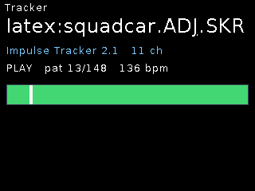
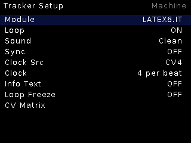

# Tracker

**Module player** (MOD/XM/S3M/IT and more via libxmp) with live performance
controls — play classic tracker modules and treat their patterns as
loopable, scrubbable material synced to your rack.

## Features

- Full libxmp playback of module files in `usr/TRACKER` (names up to 39
  characters including the extension; upload them from the web page).
- **Sequence loop** (KO-II grammar) — loop any window of rows live, from 1
  to 1024 steps, across pattern boundaries; loop jumps move the *cursor*,
  not the voices, so notes **ring across the seam**. Below one step the
  length knob becomes a **retrig** (1/2 to 1/16 of a step) that stutters
  the row at the loop position.
- On loop release the song carries on where it would have been, or, with
  **Loop Freeze** on, continues from the loop.
- **DJ filter**: low-pass to the left of noon, high-pass to the right,
  bypassed at noon, with resonance.
- **Pattern scrub** from the encoder; the jump waits for the next 16-row
  boundary and keeps the row position. A scrub ends a running loop.
- **External sync**: follows the core clock's tempo and phase, or runs
  free at the module's own tempo. While synced, the encoder nudges by
  whole steps instead of scrubbing.
- Live page: module title, type and channel count, status line (state,
  pattern, tempo — `EXT` when following the clock — loop or retrig), and
  a play bar with the loop window cut into it dark.
- Amiga or Clean output sound; optional Info Text panel listing the
  module's sample/instrument names (scrolled by knob 7 when not looping).

## Controls

| Control | Function |
|---|---|
| TR1 | Tap = play/pause, hold = restart |
| TR2 | Press = loop on/off; hold = loop only while held |
| Knob 5 | Loop position |
| Knob 6 | DJ filter |
| Knob 7 | Loop length / retrig |
| Knob 8 | Filter resonance |
| Encoder turn | Scrub patterns (nudge when synced and playing) |
| Encoder press | Module browser |
| Encoder long | Live ↔ Setup |

The knob jobs are the CV matrix defaults (Setup > CV Matrix: Loop Pos,
Filter, Loop Len, Reso) and can be moved to any CV source.

## Setup

Module, Loop (repeat the song at its end), Sound (Amiga/Clean), Sync,
Clock Src, Clock (pulses per beat), Info Text, Loop Freeze, CV Matrix.
Clock Src and Clock edit the module-wide clock.
